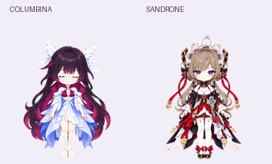
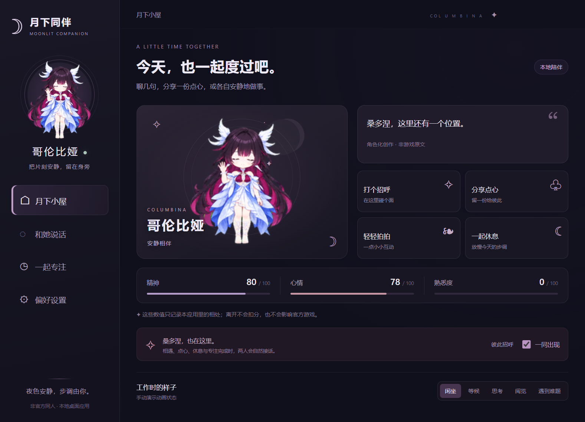

# 哥伦比娅与桑多涅 · 月下同伴

两个可以联动的 Windows 桌面同伴。哥伦比娅安静、率直而好奇；桑多涅更讲究秩序，通过行动表达关心。两位能分别拖动、一起出现，并在碰面、分享点心、休息和专注时接话。



这是《原神》非官方同人项目。形象是依据官方立绘制作的 AI 生成 Q 版改编，互动对白为原创，不是提取的游戏动画或官方台词。

## 功能

- 两个透明、无边框角色窗口；独立位置记忆、边缘吸附、显示/隐藏、可选桌面散步。
- 双人碰面招呼、分享点心、休息、专注完成与道别；对话有顺序和冷却间隔。
- 本地规则对话、轻拍互动、精神/心情/熟悉度；离线不扣分。
- 自定义专注与休息计时，支持暂停、恢复、取消和累计记录。
- 大小、不透明度、动作速度、置顶、减少动态与提醒声音设置。
- 哥伦比娅有九组动作与十六方向注视；桑多涅有五组独立动作。
- 可选 OpenAI 兼容聊天接口；默认不联网调用模型，API Key 由 Windows 加密保存。

聊天面板和可选 API 扮演哥伦比娅，桑多涅参与桌面互动和双人场景。两位共享相处数值与计时。本应用不读取游戏账号、屏幕或其他应用；工作状态动画可以手动切换，也可以选择跟随 Columbina 桌面端的任务（只读它写出的一个状态文件）。



## 从源码运行

环境：Windows 10/11 x64、Node.js 22.12.0 或更高版本、npm。Electron 固定为 `43.3.0`。

下载或克隆本仓库，在仓库根目录运行：

```powershell
npm ci
npm start
```

首次安装会下载 Electron。没有配置 API 也可以使用本地互动、联动与计时。双击角色打开小屋，右键角色或系统托盘可退出；关闭小屋面板不会退出桌宠。

## 构建 Windows 便携包

```powershell
npm ci
npm run build:portable
npm run pack:windows
```

构建从本地 `node_modules/electron/dist` 复制已安装的运行时。也可显式指定同版本官方 Windows x64 ZIP：

```powershell
powershell -NoProfile -ExecutionPolicy Bypass -File scripts/build-portable.ps1 -ElectronArchive "D:\Downloads\electron-v43.3.0-win32-x64.zip"
```

运行 `Launch-Columbina.cmd`，或打开 `portable/Columbina.exe`。分发时保留整个便携包，不能只复制 EXE。构建输出及 ZIP 均被 Git 忽略。

- `dist/columbina-sandrone-desktop-win-x64.zip`：上传到 GitHub Release 供用户下载。
- `dist/columbina-sandrone-desktop-source.zip`：干净源码包。
- 只打源码：`npm run pack:source`。

## 验证

```powershell
npm run check
npm test
```

GitHub Actions 在推送与 Pull Request 时运行相同的语法检查和单元/回归测试。它不运行图形界面，也不声称已测试真实付费 API。

本地可在构建后运行隐藏窗口冒烟测试，报告写入被忽略的 `test-output/`：

```powershell
& .\portable\Columbina.exe --smoke-test "--smoke-test-dir=$PWD\test-output\local\profile"
```

已有验证记录和未覆盖范围见 [docs/TESTING.md](docs/TESTING.md)。

## 使用与资料

- [详细使用说明与数据存储](docs/USAGE.zh-CN.md)
- [哥伦比娅角色资料与官方来源](docs/CHARACTER.md)
- [桑多涅及两人关系、联动依据](docs/SANDRONE.md)
- [GitHub 上传与 Release 发布步骤](docs/PUBLISHING.md)
- [第三方与素材说明](THIRD_PARTY_NOTICES.md)

```text
assets/              两位角色图集、动作布局与托盘图标
docs/                使用说明、角色依据、预览及发布指南
scripts/             便携构建与源码/运行包打包
test/                核心逻辑与主进程回归测试
main.cjs             Electron 窗口、托盘、IPC 与 API 请求
preload.cjs          受限的界面通信接口
core.cjs             状态、计时与持久化
renderer.js          界面互动和动画播放
persona*.json        两位角色规范与本地短句
duo-scenes.json      双人联动场景
```

## 许可

本次整理保留原有 `UNLICENSED` 状态，没有擅自赋予代码 MIT 等开源许可。公开展示源码不等同于授予开源使用许可；若维护者决定开放授权，应另行添加适用的代码许可证。角色与原作设计权利归 HoYoverse 及相应权利人所有，代码许可不代表角色素材授权。Electron/Chromium 许可证随运行包保留，详见 [第三方说明](THIRD_PARTY_NOTICES.md)。
